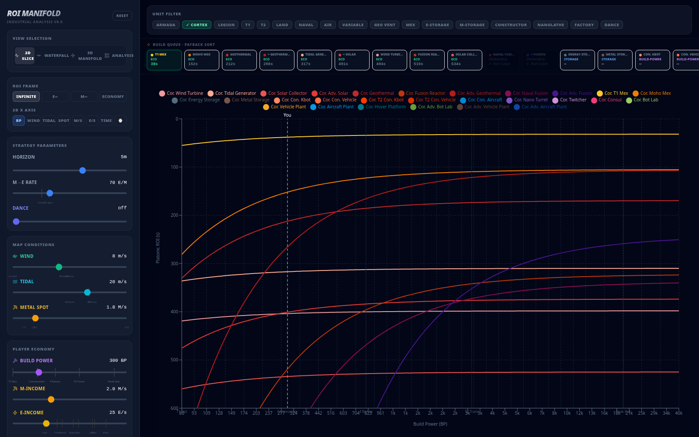
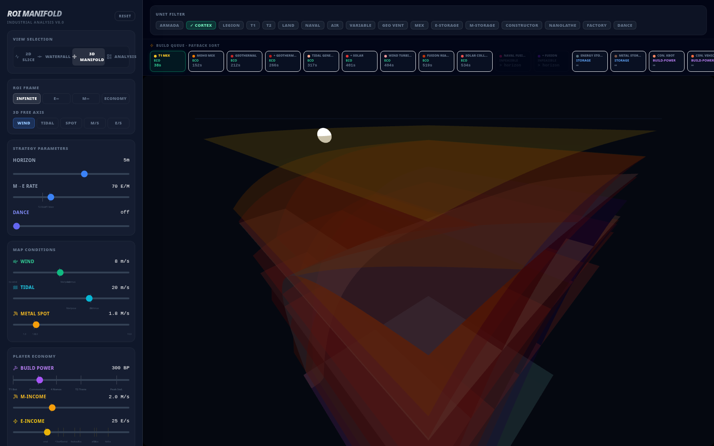
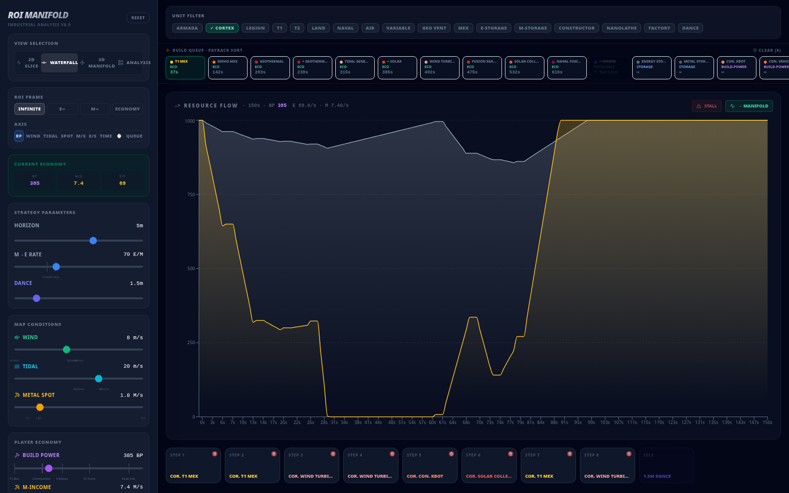
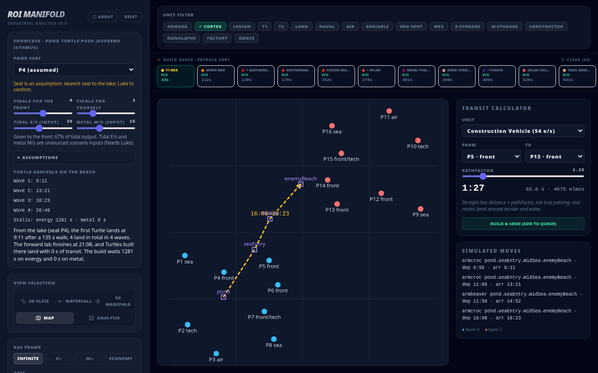
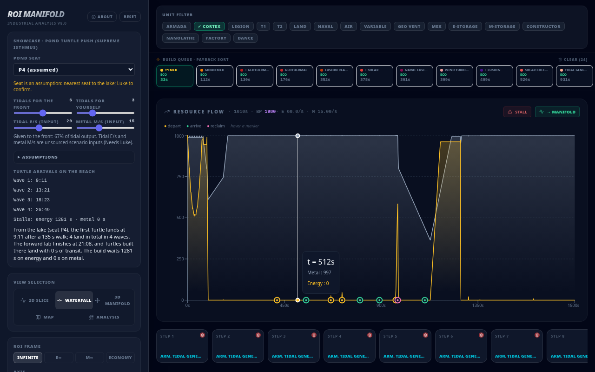

# ROI Manifold

**Live demo → https://bar.lukespooner.com**

Fallback: https://bar-eco-manifold-production.up.railway.app/

An interactive map of the economy in [Beyond All Reason](https://www.beyondallreason.info/) (BAR), the open-source RTS. Every economy building (wind, solar, fusion, mexes, storage, constructors, factories) has a payback time: how long until it has earned back its metal and energy cost, build time included. That time depends on your build power, your income, the map's wind/tidal/metal values and how far ahead you plan. The ROI Manifold treats those inputs as axes of a parameter space and draws payback across it. A 2D slice shows one axis, a 3D surface shows two, and a waterfall replays your queued builds through a resource-flow simulation. **Dance** is an idle step in the queue (wait and bank resources instead of building). Together with the **Time** axis, it shows how the best next build changes as the game goes on.



| 3D manifold | Waterfall with a build queue and trailing Dance |
|---|---|
|  |  |

## What you can do

- **2D Slice:** payback (y) for every unit in the filter against one free axis (x): build power, wind, tidal, metal spot, M/s, E/s, game time, planning horizon, or position along your queue.
- **3D Manifold:** the same payback values as surfaces over two axes (build power plus a chosen free axis), rendered with Three.js.
- **Waterfall:** click buildings in the payback-sorted strip to queue them. A tick-by-tick simulation then plots metal and energy flow, marks stalls, and feeds the end-of-queue economy back into the charts.
- **ROI frames:** *Infinite* (metal and energy combined at the M→E rate), *E∞* / *M∞* (one resource only), and *Economy* (build power capped by what your income can sustain).
- **Map:** Supreme Isthmus with every start seat, named waypoints and a transit calculator (see [Movement & distance](#movement--distance)).
- **Analysis:** a table ranking every candidate by full simulated evaluation over the planning horizon.
- **Filters:** faction (Armada / Cortex / Legion), tech level, terrain and unit role.

## Run it locally

Requires Node 22 (see `engines` in `package.json`).

```bash
npm install
npm run dev        # Vite dev server
npm test           # econ unit tests (node:test, no extra deps)
npm run build      # static production build in dist/
npm run preview    # serve the build
```

There's also a headless-browser smoke check that loads the app and reports runtime errors. It needs `@playwright/test` installed globally:

```bash
./tools/check_app http://localhost:5173
./tools/check_app https://bar.lukespooner.com    # the live site
```

## Movement & distance

Units take time to get places, so the queue can include more than builds.



- **Map model:** `src/maps/supremeIsthmus.js` holds the 16 start seats (elmos) and a few hand-picked waypoints. `src/maps/index.js` has `distance`, `pathLength` and `transitSeconds`. The map lists enclosed water in `landlocked` (`['pond']` on Supreme Isthmus).
- **Transit time:** straight-line length between points × `pathFactor` (default 1.15), divided by the unit's speed in elmos/s from `src/data/barMobility.js`. It is not real pathing: real routes bend around terrain and water.
- **Queue steps:** `build` at a location, `move` along a route, and `reclaim`. A unit that has to walk is not available until it arrives; a lab built at the destination lands units with 0 s of transit. The simulator logs `depart` and `arrive` events, which the waterfall draws as movement markers.
- **Reclaim:** a `reclaim` step returns the unit's **metal only, never energy**, at `RECLAIM_METAL_FRACTION` (1, so 100%). It comes back **in one lump when the reclaim completes** (`RECLAIM_UNIT_METHOD = 1`). Nothing is returned mid-reclaim, and nothing is returned if the horizon cuts it off. Source: BAR [`gamedata/modrules.lua`](https://github.com/beyond-all-reason/Beyond-All-Reason/blob/master/gamedata/modrules.lua) (`reclaim.unitEfficiency = 1`, `unitMethod = 1`). The simulator logs a `reclaim_complete` event, which the waterfall marks.
- **Landlocked-lake ship guard:** a `move` out of a landlocked waypoint by a non-amphibious ship (BAR `BOAT*` / `UBOAT*` movement class) is skipped with a `move_blocked` event. That is why Voyagers and the shipyards stay in the lake.

### Showcase: Pond amphibious Turtle push

The intro's showcase button loads a Supreme Isthmus scenario (`src/scenarios/pondTurtle.js`): an Armada support seat behind the causeway fronts opens with about 6 tidals for the front players and 3 for itself, then builds a lab at the landlocked crater lake. Only amphibious units (Turtle, Beaver) can leave that lake. They walk pond → seaEntry, cross the north-west sea and land on the enemy beach, where a forward Amphibious Complex then builds Turtles with no transit.

Assumptions, as they are in code (all listed in the app under "Assumptions"):

- The seat is **P4** (nearest to the lake). This is an assumption and still needs Luke's confirmation; P7 and P2 are selectable.
- Waypoints were picked by eye from the public minimap, so they are approximate.
- Partner holds the sea: no losses are modelled, and the commander starts at the lake.
- **Needs Luke:** tidal output (20 E/s each), metal income (15 M/s), commander build power (300) and start resources (1000 M / 1000 E) are scenario inputs, not sourced values. They are visible and adjustable where the UI exposes them.



## Architecture

The code has three layers. A generic manifold UI sits on top, a BAR-specific driver sits under it, and a pure economics engine sits at the bottom.

```
src/
├── manifold/          generic "parameter space + function" UI
│   ├── Navigator.jsx      app shell: controls, cursor, view switching
│   ├── hooks/useCursor.js single cursor shared by sliders, charts and picker
│   ├── views/             SliceChart (2D), Surface3D (Three.js), PathChart (waterfall)
│   └── types.js           JSDoc interfaces: Manifold, AxisDef, Cursor, Path
├── bar/               BAR driver: plugs the game into the manifold interface
│   ├── driver.js          BAR_AXES and createBarManifold()
│   ├── computeROI.js      fast analytical payback for live charts (4 ROI frames)
│   ├── income.js          wind / tidal / mex / fixed income per unit
│   └── classify.js        ECO / STORAGE / BUILD-POWER / ... labels
├── econ/              economics engine (plain JS, no React)
│   ├── simulateBuildQueue.js  time-stepped queue sim with stalls and storage caps
│   ├── evaluateCandidate.js   full candidate evaluation over a horizon
│   ├── continuousManifold.js  grid sampling of the best candidate across axes
│   └── ...                    state, scoring, value model, explanations
├── data/barStats.js   unit catalogue (costs, build time, output, tags, colours)
└── components/        EconCandidateTable (analysis view)
```

`manifold/` doesn't need to know it's drawing a game. It takes a `Manifold` (axes, evaluators, colour/label encoders and a unit catalogue), and `bar/driver.js` provides one for BAR. `econ/` is what `tests/econ.test.mjs` covers.

## Data

Unit stats in `src/data/barStats.js` come from the game's own Lua unit definitions in [beyond-all-reason/Beyond-All-Reason](https://github.com/beyond-all-reason/Beyond-All-Reason). Thanks to the BAR team and contributors.

- `tools/scrape_bar_units.py` downloads the Armada, Cortex and Legion economy, constructor and factory unit files from that repo's `master` branch and caches them in `tools/cache/` (gitignored).
- `tools/gen_bar_stats.py` turns the cache into the `BAR_STATS` block, adding colours and tags. Neither of those is game data.

```bash
python3 tools/scrape_bar_units.py
python3 tools/gen_bar_stats.py      # prints the generated block and a diff
```

`gen_bar_stats.py --write` rewrites the `BAR_STATS` block in `src/data/barStats.js` (keeping hand-added entries such as `dance`, and everything after the block) and regenerates `src/data/barMobility.js`: speed (elmos/s), movement class, health, build power and water depths per unit, keyed like `BAR_STATS` plus by BAR id (e.g. `armcroc`).

- `tools/gen_map_model.py` generates `src/maps/supremeIsthmus.js` (seat positions) from [beyond-all-reason/maps-metadata](https://github.com/beyond-all-reason/maps-metadata) `map_list.yaml` (Apache-2.0).
- Speeds, movement classes and water depths in `src/data/barMobility.js` come from the same BAR unit definitions as the stats.

The stats are a snapshot from whenever the scraper last ran, so they may not match the current game balance patch.

## Licence

Code: [MIT](LICENSE), except one file.

- [`src/data/barStats.js`](src/data/barStats.js) is licensed under [GPL-2.0](LICENSES/GPL-2.0.txt). Its unit values (costs, build time, output, storage) are extracted from the GPL-licensed unit definitions in [beyond-all-reason/Beyond-All-Reason](https://github.com/beyond-all-reason/Beyond-All-Reason) ([their licence](https://github.com/beyond-all-reason/Beyond-All-Reason/blob/master/LICENSE.md)). Credit to the Beyond All Reason team and contributors.
- No BAR models, textures, animations, artwork, icons, unit pictures, music or sounds are used or redistributed here.
